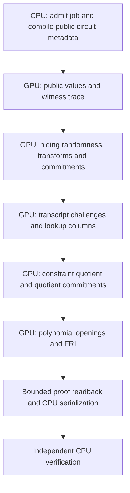

# GPU proving

Use [GPU benchmarking](gpu-benchmarking.md) for commands. This page describes the current integrated source; historical measurements and detailed development logs are in the [archive](archive/gpu-acceleration-2026-10-17.md).

The [20 October 2026 V100 profiling report](v100-gpu-profile-2026-10-20.html) documents a fresh profiling campaign from the previous optimized source, shared transform factors, paired timings, power measurements, correctness checks, and compilation costs. Its [machine-readable evidence](evidence/v100-gpu-profile-2026-10-20.json) preserves individual measurements and source identities. The [19 October report](v100-gpu-profile-2026-10-19.html) retains the preceding arithmetic and witness scheduling experiments.

The [third V100 optimization pass](v100-gpu-profile-2026-10-20-pass3.html) starts from that shared-transform build. It measures constant-index sponge absorption and delayed reduction of the Poseidon2 internal sum, with fresh paired proofs and independent CPU verification. Its [evidence](evidence/v100-gpu-profile-2026-10-20-pass3.json) includes rejected squaring experiments and the NVIDIA references used to guide the work.

The [fourth V100 optimization pass](v100-gpu-profile-2026-10-20-pass4.html) measures delayed reduction of the Poseidon2 external matrix and fixed-stage bit reversal. Its [evidence](evidence/v100-gpu-profile-2026-10-20-pass4.json) retains all paired proof timings, independent CPU verification, integer oracles and rejected kernel variants.

The [fifth V100 optimization pass](v100-gpu-profile-2026-10-20-pass5.html) measures delayed internal matrix reduction, a fixed inverse chain and shared quotient inversion. Its [evidence](evidence/v100-gpu-profile-2026-10-20-pass5.json) retains all paired proof timings, independent CPU verification, integer oracles and rejected kernel variants.

The [sixth V100 optimization pass](v100-gpu-profile-2026-10-21-pass6.html) measures explicit carry and borrow instructions for Goldilocks arithmetic behind a V100 device gate. Its [evidence](evidence/v100-gpu-profile-2026-10-21-pass6.json) retains all paired proof timings, independent CPU verification, integer oracles and rejected kernel variants.

The [seventh V100 optimization pass](v100-gpu-profile-2026-10-21-pass7.html) measures delayed modular reduction in cubic extension multiplication behind the existing V100 device gate. Its [evidence](evidence/v100-gpu-profile-2026-10-21-pass7.json) retains all paired proof timings, independent CPU verification, integer oracles and rejected kernel variants.

The [eighth V100 optimization pass](v100-gpu-profile-2026-10-21-pass8.html) measures explicit carries in the bounded Poseidon matrix reducer behind the existing V100 gate. Its [evidence](evidence/v100-gpu-profile-2026-10-21-pass8.json) retains paired complete-proof timings, independent CPU audits, arithmetic oracles and the rejected NTT experiments.

The [ninth V100 optimization pass](v100-gpu-profile-2026-10-21-pass9.html) evaluates and rejects one-fold addition for canonical Poseidon round constants after mixed proof timings and higher sampled VRAM; the prior optimized source is retained. Its [evidence](evidence/v100-gpu-profile-2026-10-21-pass9.json) retains all paired complete-proof timings, independent CPU audits, boundary oracles and rejected arithmetic/NTT experiments.

The [tenth V100 optimization pass](v100-gpu-profile-2026-10-21-pass10.html) retains fusion of the first NTT butterfly with global input loads behind the existing V100/shared-NTT guard. Its [evidence](evidence/v100-gpu-profile-2026-10-21-pass10.json) retains all paired complete-proof timings, independent CPU audits, integer NTT oracles, the corrected synchronization experiment and rejected store-fusion variants.

The [eleventh V100 profiling pass](v100-gpu-profile-2026-10-22-pass11.html) retains the pass 10 implementation after testing four NTT candidates and three Poseidon2 S-box schedules. The [structured evidence](evidence/v100-gpu-profile-2026-10-22-pass11.json) includes the fixed hash confirmation, every complete-proof comparison, independent CPU audits, and the rejected kernel experiments.

## Backends

| Platform | Build feature | Execution and qualification |
|---|---|---|
| Linux OpenCL | `gpu` | Device buffers, GPU proving stages, and systemd resource controllers. The current inventory/admission scripts require NVIDIA UUIDs and `nvidia-smi`. |
| Apple Silicon | `gpu-metal` | Metal compute, shared-memory prefixes, compact salts, and public preprocessing sharing. Use native Mac qualification. |
| CPU | Neither GPU feature | Independent verification, fixture preparation, reference proofs, and correctness checks. |

Select exactly one GPU transport. Use explicit feature sets and separate target directories when comparing backends. OpenCL code availability alone does not establish AMD or Intel controller support.

## Proving policy and ownership

The proving request records which stages may execute on each backend. Strict GPU requests must reject unavailable stages and cannot silently claim a CPU fallback as GPU work. Device-owned paths retain trace, quotient, opening, and FRI data on the GPU where supported. Completion accounting checks the operations actually performed.

Apple and OpenCL share proving interfaces but have different storage implementations. Metal can retain shared host/device prefixes; OpenCL can retain device-owned buffers. Public preprocessing sharing must preserve profile and input identity. Private salt storage, scratch ownership, allocation limits, and phase lifetimes remain explicit.

CPU verification of a produced proof is separate from prover placement. Do not change proof parameters, randomness, or verification rules to improve a hardware benchmark.

## Workers and memory

Start with one worker per GPU. A pool can schedule independent jobs across multiple devices; sharing one device between workers is an opt-in experiment with additional admission requirements. Host RAM, managed device memory, per-allocation bounds, driver/context overhead, scratch, and free-memory headroom all count.

The full owned proving path holds its heavy memory phase through proof completion. The host-trace path can release that phase after retiring trace prefixes and entering the bounded late phase. Apple and Linux experiment settings use separate environment namespaces.

## How a GPU proof is produced

The prover is a host-controlled STARK pipeline. The CPU admits the job, builds public circuit and dependency metadata, submits bounded GPU work, and serializes the proof. The GPU executes the arithmetic stages. `gpu_required` checks receipts for those individual stages; a GPU-enabled build or a single accelerated transform is not sufficient evidence of a complete GPU proof.

1. **Admission and public compilation.** A worker reserves host memory, managed GPU memory, driver context space, and any allowed spill storage before allocating the trace. The host records the public AIR and compiles instruction/layout metadata. Recursive witness operations are ordered into dependency levels; arithmetic within a level can execute in parallel. Public programs and preprocessing can be reused across jobs, while private buffers and randomness remain owned by one proving attempt.
2. **Public values and witness construction.** Device kernels derive the statement and evaluate the witness program into the AIR's row layout. The host uploads bounded inputs and immutable metadata. Intermediate wires and the completed witness trace stay on the device. Execution status is checked before committing an invalid witness. Native wallet circuits have their own device witness builders; recursive circuits execute the compiled instruction schedule.
3. **Hiding, transforms, and commitments.** Fresh randomness supplies hiding rows, salt fields, and random codewords. Low-degree extension uses finite-field transforms and coset scaling. Poseidon2 hashes the extended rows and builds Merkle commitments. Public preprocessing has its own commitment where the AIR requires it. Tiling, retained device prefixes, and admitted host storage keep each operation within its memory plan.
4. **Transcript and lookup arguments.** The GPU transcript observes commitments and public values in the verifier's prescribed order and samples challenges. Recursive AIRs evaluate lookup expressions, inverses, and permutation columns, then commit those columns. The native wallet AIRs covered here have no lookup argument.
5. **Constraint quotient.** Host compilation lowers the public symbolic AIR to an instruction program. On supported NVIDIA devices and admitted shapes, it also builds a specialized OpenCL evaluator; other supported shapes use the device interpreter. GPU kernels evaluate constraints over the extended domain, combine them using transcript challenges, and construct and commit quotient chunks. This runtime compilation can dominate a first-use run.
6. **Openings and FRI.** Device kernels evaluate the requested polynomial openings, batch denominator inversions, combine codewords, fold and commit FRI layers, and compute the final polynomial. The transcript determines query indices and grinding challenges. Bounded gathers return the required evaluations and authentication paths rather than copying every intermediate matrix back to the host.
7. **Proof output and verification.** The CPU assembles and serializes the protocol's proof object. Completion drains pending device work and releases private storage. A separately built CPU verifier checks the resulting statement and proof. Verification time is recorded separately when the benchmark's proving timer excludes it.

On the measured Tesla V100-PCIE-32GB, sufficiently large transforms share each stage's butterfly factors across columns and repeated row blocks in workgroup-local memory. The default selects this kernel for at least 16,384 rows with 16 or more columns, or at least 262,144 rows with 3 or more columns. Admission accounts for the tile, root powers, optional row scales, and the additional half-tile of shared factors. If that complete layout does not fit, the existing cached or uncached transform remains available. Small transforms retain their previous path because the extra synchronization caused regressions in component measurements. Other devices and the Metal backend retain their existing selection policies.

The OpenCL LDE sponge finishes any pending partial block, absorbs complete four-word blocks with constant state indices, and retains the final suffix for the next tile or finalization. This removes the measured V100 kernel's 64-byte private state allocation. The shared Poseidon2 internal round sums eight field representatives in two 32-bit limb accumulators and performs one field reduction; both accumulators remain below 2^35. CPU oracles cover noncanonical values and every partial-block offset. The Metal implementation is separate, and these performance measurements cover only the tested V100 configuration.

The stage inventory is `PublicValues`, `WitnessTrace`, `Preprocessing`, `Lookup`, `Transform`, `Quotient`, `Randomness`, `Hiding`, `Commitment`, `Opening`, `FriFold`, `FriQuery`, `FinalPolynomial`, `Scalar`, `Transcript`, and `Grinding`. This inventory describes coverage, not a one-pass execution order: transforms, hashing, transcript operations, and commitments recur throughout the pipeline. Native wallet proofs require the same inventory without `Lookup`.

### Wallet proofs and recursive aggregation

The legacy wallet profile uses quadratic extension challenges and 96 FRI queries. The recursive profile uses cubic extension challenges and 128 queries. Both use hiding, a 16-fold LDE blowup, and 16 query grinding bits. These are distinct proof profiles with independent CPU verification; benchmarking preserves their parameters and formats.

The V100 aggregation fixture starts with already-produced wallet proofs. Four inputs require two pair wrappers and one merge: three fresh recursive proofs. Eight inputs require four wrappers and three merges: seven fresh proofs. Two concurrent eight-input jobs produce two independent roots and fourteen fresh recursive proofs. Their throughput does not include creation of the original wallet proofs or establish the latency of a single sixteen-input tree. The separate native wallet benchmark measures a fresh JoinSplit proof from a fixed witness.

## Native GPU wallet startup

The native wallet integration is built with `-Dgpu-prover=true` and an explicit proving policy such as `gpu-required`. The default mock demonstration cannot satisfy a strict proving request. See the [native integration instructions](../lattica-prover-p3/scripts/block-v2-pool-README.txt) and retained [startup details](archive/gpu-acceleration-2026-10-17.md#native-gpu-wallet-startup) before using that path.

## Current limits

The merged code needs new per-device checks. Historical RTX 5080 and Apple results do not qualify this head, a different driver, or a different proof capacity. Full cold aggregation, finalization deadlines, durable host delivery, and security review remain distinct gates. See [block proving](block-proving-v2.md) and [bounded execution](bounded-execution-engine.md).
