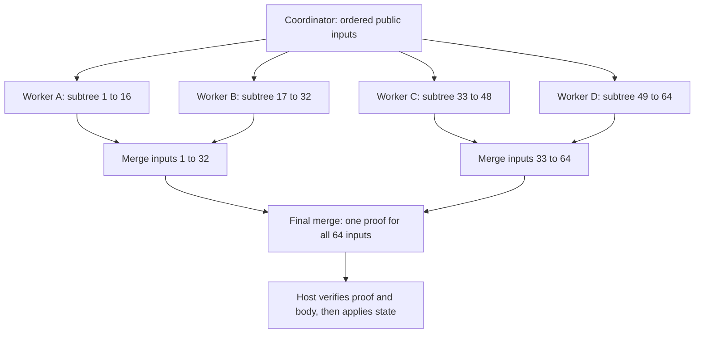
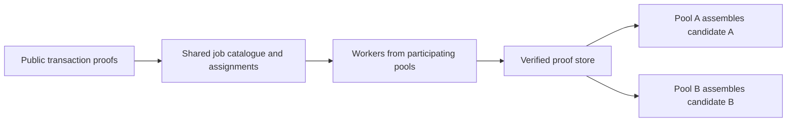

# Lattica proving pool architecture

A proving pool distributes recursive proof jobs across CPU and GPU workers and
combines their results into one proof for an ordered block body. Its main
opportunities are parallel execution, preparing subtrees before block selection
is sealed, and reusing compatible work. The final dependent proof stages, host
validation and block cadence still bound useful transaction throughput.

This guide covers job boundaries, final aggregation, continuous scheduling,
hostile participants and competing pools. It recommends extending the existing
local dependency graph with verified subtree exchange and coordinated remote
assignments. Independent pools cannot be forced to avoid every duplicate
computation.

## Contents

- [Proof jobs and the final block](#1-proof-jobs-and-the-final-block)
- [Continuous proving and block cadence](#2-continuous-proving-and-block-cadence)
- [Throughput and resource limits](#3-throughput-and-resource-limits)
- [Hostile workers and coordinators](#4-hostile-workers-and-coordinators)
- [Competing pools and reusable proofs](#5-competing-pools-and-reusable-proofs)
- [Recommended direction and alternatives](#6-recommended-direction-and-alternatives)

## Implementation status

**Status reviewed on 2026-10-08.** Local implementation and dated validation are
distinct from proposed network services and protocol changes.

| Capability | Status and evidence |
|---|---|
| Individual proof jobs, dependency readiness, shared candidate work and attempt fencing | Implemented local interfaces in the [job contracts](../lattica-prover-p3/src/block_v2/execution/job.rs), [durable graph](../lattica-prover-p3/src/block_v2/execution/dag.rs) and [pool](../lattica-prover-p3/src/block_v2/execution/pool.rs). |
| Persistent local GPU pool | The [2026-10-06 smoke record](evidence/block-v2-persistent-pool-2026-10-06.json) contains two four-input roots, eight fresh recursive proofs, independent CPU audits and native commits using the same two worker processes. It establishes a small correctness and lifecycle result. |
| Distributed worker transport, shared assignments across pools and permissionless settlement | Proposed services; the local smoke result does not qualify them. |
| Sustained delivered throughput and complete full-size timing | Remain qualification gates. The smoke record explicitly leaves throughput gain unqualified. |
| Larger block capacity and three-minute transaction cadence | Research proposals requiring protocol, security and host review. |

[Block proving v2](block-proving-v2.md) controls candidate construction and release
gates; [SPEC.md](../SPEC.md) controls protocol requirements. The
[distributed roadmap](distributed-proving.md),
[throughput plan](high-throughput-proving-plan.md) and
[GPU implementation plan](dag-gpu-implementation.md) retain their respective
service, performance and implementation roles. This guide introduces no runtime
API, allocated network format or consensus activation. Recorded tests apply to
their recorded builds; subsequent source changes need their own qualification.

## 1 Proof jobs and the final block

### Smallest useful units

| Layer | Unit of work |
|---|---|
| Wallet | Produce a transaction proof from a private witness. |
| Aggregation | Execute one registered wrapper, merge, empty or finalizer operation. |
| Remote assignment | Execute one operation or a contiguous subtree containing several operations. |
| GPU backend | Execute kernels and manage buffers within a proving operation. |

The smallest aggregation job is one proof operation. A subtree is a useful remote
assignment because intermediate proofs, large matrices and scratch data can stay
on one host. Assigning sixteen inputs to a worker does not create a new circuit
that verifies sixteen wallet proofs at once. It can execute the existing paired
wrappers and binary merges locally.

Workers receive completed wallet proofs and the public information needed to
bind them. Spending keys, private note witnesses and producer issuance witnesses
remain with their owners. Each new proof attempt uses fresh prover randomness.
Preprocessing caches retain approved immutable public data, never RNG state or
hiding masks. Completed proofs can be reused when their statements and current
eligibility match.

### Building one root

For a full 64-input paired construction, the graph contains:

```text
32 pair proofs -> 16 merges -> 8 merges -> 4 merges -> 2 merges -> 1 root
```

That is **63 recursive proof jobs**, excluding wallet proof generation. Four
workers could each produce a sixteen-input subtree using fifteen local jobs,
followed by three upper merges:



Every merge proves verification of its two approved children and binds their
ordered commitments, counts, level and required context. A remote subtree proof
therefore establishes its internal verification chain. The coordinator verifies
the exported result against its independently expected statement; downloading
every internal proof is unnecessary for that acceptance check.

At full capacity, the top merge is the final root proof. For smaller typed
selections, the [selection builder](../lattica-prover-p3/src/block_v2/execution/selection.rs)
uses the registered empty and finalizer paths to reach the required depth. These
operations must preserve the real input count and canonical padding.

The host recomputes the expected commitment from the canonical block body,
verifies the aggregate proof with its approved registry, checks current state
rules and applies the state changes atomically. State checks include nullifiers,
anchors, heights, fees and authorized issuance. A worker's claimed root or a
coordinator's success receipt cannot replace those checks.

The [recorded 64-input root](evidence/block-v2-vram16-capacity-count-64-2026-10-06-r2.json)
is 1,683,948 bytes, about **1.61 MiB**, within the candidate's 2 MiB limit. The block
carries one final proof and its public body. Intermediate proofs remain off-chain
for service reuse or recovery and are unnecessary for historical root verification.

## 2 Continuous proving and block cadence

### Schedule on dependency completion

The [local pool](../lattica-prover-p3/src/block_v2/execution/pool.rs) already selects
ready jobs from the dependency graph. A complete distributed service should:

1. Admit eligible public inputs and assign stable ordered positions.
2. Start independent proof jobs as resources become available.
3. Verify and durably store each returned proof.
4. Dispatch a parent as soon as all of its required children are accepted.
5. Reuse unaffected completed subtrees while other branches progress.
6. Seal the selection, finish the remaining root path and perform host validation.

One branch can advance while another is still waiting. No global barrier between
tree levels is required. A set of completed subtree proofs can be maintained as
an internal forest while the final commitment retains the approved ordered tree.

Attaching an already verified result is a scheduling and storage operation.
Producing its parent is another cryptographic computation. If four completed
subtrees leave two dependent merge levels, hypothetical ten-second merges leave
at least about twenty seconds of proving before transfer and host checks. Extra
idle workers cannot execute the last merge before its children exist.

### Preserve order and eligibility

Proof completion order must not determine transaction order. Otherwise, a slow
or hostile worker can influence selection and invalidate reusable work.
Reordering or replacing an input invalidates affected ancestor statements;
reorganizations or height changes can also invalidate eligibility or context.

At sealing, freeze the exact selection and recheck eligibility. Under the current
dense-prefix construction, completed proofs around a missing input cannot simply
be packed into new positions without rebuilding or checking compatible reuse.
Late work is deferred according to the candidate policy. Any smaller selection
must still include valid issuance and produce the approved padded root.

Issuance can depend on selection, fees and producer context. Reserve its capacity
and include its complete proof path in the deadline estimate. Do not assume that
only the final merge remains after sealing. Retain fast, dependable workers near
the coordinator for the remaining critical path.

### Research cadence

Scheduling should be event driven. Block cadence is a separate protocol choice.
The [throughput proposal](high-throughput-proving-plan.md#5-proposed-capacity-and-cadence-specification)
keeps the nominal 90-second PoW interval and evaluates transaction blocks every
second height instead of every eighth. That gives an expected three-minute
transaction cadence; PoW arrivals remain variable.

A useful first cadence experiment keeps the 64-input construction, followed by
the proposed larger profile. The arithmetic below assumes **four issuance inputs
per block** solely for comparison:

| Configuration | Nominal transaction interval | User-input capacity divided by interval |
|---|---:|---:|
| Existing 64-input candidate | 12 minutes | 60 / 12 = 5 per minute |
| Suggested 64-input cadence experiment | 3 minutes | 60 / 3 = 20 per minute |
| Proposed 512-input profile | 3 minutes | 508 / 3 = 169.3 per minute |

These are capacity ceilings, not measured service rates. The four-issuance
assumption does not establish a new payout rule. The proposed 512-input profile's
initial useful-rate qualification target is 100 user transactions per minute.

For the three-minute research cycle, the
[critical-path target](high-throughput-proving-plan.md#critical-path-budget) is
**60 seconds from sealing to a host-ready root and body**, including final
verification. Measure durable application as well. This target does not replace
the current qualification contract's 180-second complete post-seal gate or its
600-second cold full-64 gate. None is evidence that those timings have passed.

Cadence changes require explicit review of issuance and fees, payout participants,
HTLC height rules, anchor age, propagation, reorganizations and missed-slot
behavior. Capacity changes also affect counts, encodings, tree depth, proof
geometry and full-tree security. Faster publication of progress receipts does
not establish block inclusion or consensus finality.

## 3 Throughput and resource limits

### Measured reference and illustrative scaling

The [2026-10-06 capacity trial](evidence/block-v2-vram16-capacity-count-64-2026-10-06-r2.json)
completed 63 fresh recursive jobs in **2,112.215 seconds, or 35.2 minutes**, on one
RTX 5080 Laptop GPU worker. Its 64 inputs contained 48 user transactions and
16 issuance inputs. The run reused existing wallet proofs and registered keys;
it excluded fresh wallet proving, native delivery, complete cold start and
sustained service qualification.

Dividing 48 by 35.2 gives approximately **1.36 user-input equivalents per minute
of recursive work**. This is not delivered transaction throughput. The recent
small empty-recursion CPU/GPU comparison also cannot establish a full-block
speedup; its [measured fixtures](evidence/cpu-gpu-progress-comparison-2026-10-08.json)
contain no user transactions.

For an illustrative single-root schedule, assume every recursive job takes
`t = 2112.2152788470266 / 63` seconds and every worker has the reference worker's
full resources and speed. A level-by-level schedule has duration:

```text
T(K) = t * sum(ceil(jobs_at_level / K))
jobs_at_level = [32, 16, 8, 4, 2, 1]
```

| Equal workers K | Modeled recursive aggregation time |
|---:|---:|
| 1 | 35.2 minutes |
| 2 | 17.9 minutes |
| 4 | 9.5 minutes |
| 8 | 5.6 minutes |
| 32 | 3.4 minutes |

This reproducible model uses level boundaries for calculation; implementation
dispatch remains dependency driven. It assumes equal job costs, no added network
or contention cost, and no retries. It excludes wallet generation and final host
processing. The multi-worker rows are not distributed benchmarks or deadline
guarantees. Actual remaining level costs determine the critical path.

### Capacity and delivered throughput

For a homogeneous worker class, a first recursive-work capacity model is:

```text
user inputs per minute ~= 60 * K * u * (N - I) / W(N)
```

Here `K` is the number of full worker slots, `u` the planned useful utilization,
`N` total inputs, `I` issuance inputs, and `W(N)` occupied worker-seconds per root.
Measure blocking transfers, verification, retry and duplicate-work costs, and
account separately for wallet, coordinator and host resources. This estimates
aggregate capacity; individual roots must also meet their dependency deadlines.
Single-chain inclusion is additionally bounded by `(N - I) / B`, where `B` is the
block interval in minutes, and by networking and state application.

A worker slot includes its assigned CPU threads, host RAM, device memory and
scratch allowance. It is not one CPU thread. Budget heterogeneous workers by
measured job class and resource allocation; CPU and GPU activity for the same
job must not be counted as independent completed work.

The reference run reserved **37.25 GiB of host RAM** and sampled **6.63 GiB of GPU
process memory**. These are observations for that assignment, not universal worker
budgets or continuous VRAM maxima. The resource planner must use the actual host,
cgroup limits, GPU and qualified profile. Charge tmpfs spill within host RAM,
keep idle caches reserved, account for driver/context headroom and place CPU
threads and memory near the assigned GPU where possible.

Additional VRAM helps when it avoids transfers or recomputation or admits a
larger working set. Raising a reservation alone adds no computation capacity.
Across hosts, transfer public proof artifacts and manifests while generating
large matrices locally. Larger subtree assignments reduce network traffic but
increase lost work and tail latency when a worker fails.

Count useful transactions only after independent root verification, native body
validation and durable application. Keep issuance, retries, duplicates, backlog,
reversals and deferred transactions separate. The
[persistent pool campaign instructions](../lattica-prover-p3/scripts/block-v2-pool-README.txt)
define the existing measurement boundary and qualification workflow.

## 4 Hostile workers and coordinators

### Separate validity from availability

Proof correctness relies on sound circuits, approved parameters, the pinned
verifier and correct host validation. It does not rely on a majority of workers
claiming success. Source-level checks and successful tests do not replace the
required full-tree soundness and zero-knowledge review.

Availability requires enough capable workers, accessible inputs, bounded queues
and recovery capacity. If every available worker withholds results, the service
cannot promise completion. A coordinator can also censor transactions, choose a
permitted ordering or withhold work, blocks or payment. Honest host validation
prevents those service powers from bypassing block validity checks.

### Required remote acceptance and recovery

The following is the required remote-service behavior. The current local service
has the error-containment gap described below.

```mermaid
flowchart TD
    R["Result arrives"] --> G{"Lease, bounds and encoding valid?"}
    G -->|No| X["Reject submission"]
    G -->|Yes| V{"Proof verifies against expected statement?"}
    V -->|No| F["Reject attempt and contain worker fault"]
    F --> Q["Requeue eligible work within deadline"]
    V -->|Yes| S["Make verified artifact durable"]
    S --> C{"Attempt still current at commit?"}
    C -->|No| Z["Discard stale completion"]
    C -->|Yes| A["Atomically accept one completion"]
    A --> P["Release newly ready parent jobs"]
    E["Lease expiry or worker loss"] --> Q
```



Recompute the expected statement from pinned inputs and verify with the
coordinator's approved registry. Never select a key, geometry or weaker profile
from an untrusted result. Freeze exact input artifact digests when dispatching a
parent. A second randomized proof for the same statement must not silently
replace an in-flight input.

Check attempt ownership again when committing acceptance because a lease can
expire during verification. An old submission must not cancel a different live
attempt or decrement a dependency counter twice. Lease and candidate epochs are
operational bindings; the recursive statement does not authenticate every such
field. A verified late artifact may be retained for compatible future reuse
without reopening a cancelled candidate or awarding duplicate credit.

| Threat | Required control |
|---|---|
| False proof or substituted inputs | Verify the exact expected statement and pinned profile before accepting the result. |
| Replay or duplicate completion | Fence attempts and coordinator epochs; publish one durable accepted completion per logical job. |
| Withholding, disappearance or endless heartbeats | Absolute deadlines, bounded leases, input availability outside the worker and eligible reassignment. |
| Oversized, malformed or expensive submissions | Bound encoded and decoded sizes, admission and verification queues; isolate and limit verifier work. |
| Corrupt artifacts or poisoned caches | Check lengths, digests, formats and profile bindings, then required proof validity. A digest alone is insufficient. |
| Fake hardware claims or many identities | Qualify workers with fresh tasks, measure accepted work and enforce aggregate limits with an explicit participation policy. |
| Malicious job commands or downloads | Run installed, approved backends; restrict data formats, fetch destinations and filesystem access; enforce worker-local limits. |
| Stolen work, duplicate rewards or coordinator nonpayment | Explicit assignment and settlement rules; proof validity alone does not establish authorship or compel payment. |

Authenticated encrypted transport and scoped artifact access protect sessions and
data movement. They do not make a peer truthful. Public transaction timing and
grouping can still reveal metadata. Keep wallet secrets and unrelated worker
credentials outside the aggregation environment.

Expiring a remote lease revokes its authority to complete the job; it cannot force
an untrusted machine to stop computing. Reassignment elsewhere must tolerate a
late old result. For locally controlled devices, release physical reservations
only after observing the required process or device cleanup. Remote claims are
not evidence that local hardware resources have been released.

### Existing protection and the service gap

[VerifiedNode](../lattica-prover-p3/src/block_v2/execution/job.rs) bounds proof size,
checks the pinned registry and verifies the expected public statement. The local
graph and pool provide durable acceptance and attempt fencing.

However, an invalid proof currently returns an error from
[the pool step](../lattica-prover-p3/src/block_v2/execution/pool.rs), propagated by
[the local service loop](../lattica-prover-p3/src/bin/typed_common/execution_pool_service.rs).
Before exposing the service to hostile workers, contain attributable failures to
the worker and attempt, requeue eligible work and keep unrelated jobs running.
Shared-state corruption must still fail closed rather than being treated as an
ordinary worker error. Protocol decoding and resource isolation need their own
adversarial qualification.

## 5 Competing pools and reusable proofs

### Duplicate computation and different statements

A wallet proof can accompany its transaction to several pools. Those pools may
reuse it while producing different recursive aggregations. For example:

| Candidate | Ordered inputs | Potential shared subtree |
|---|---|---|
| Pool A | A, B, C, D | A, B |
| Pool B | A, B, E, F | A, B |

The `A, B` proof is reusable only when its profile, required context, operation,
range and expected statement are compatible. The two final roots cover different
statements. A grouping such as `A, C` needs different work. Current
[job identities](../lattica-prover-p3/src/block_v2/execution/job.rs) include position
and dependency identities; a transaction ID alone is insufficient for cross-pool
deduplication.

Randomized proof bytes have separate artifact identities. They are deliberately
excluded from semantic job identity where the verified statements already bind
the work. Several valid artifacts can represent one logical job. Keep that
distinction when indexing, leasing and paying for work.

Repeated computation is also distinct from double spending. Canonical state
validation prevents the same spend from being applied twice on one chain. It
does not prevent competing candidates from including the same transaction before
one wins. Recheck eligibility and retire affected candidate work after a head
change, while preserving compatible shared work still needed elsewhere.

### Proposed shared proving layer



The proposed workflow is:

1. Publish exact reusable batch manifests with approved profiles, ordered inputs,
   expected statements and required context. Different mempools can contain
   different sets; deterministic sorting alone cannot establish agreement.
2. Look up a semantic job before proving. Retrieve and independently verify an
   available compatible result.
3. Otherwise consult assignments. Wait within the deadline policy for an active
   lease, or atomically claim an available job under the agreed authority.
4. Publish a verified, retrievable result under immutable artifact identities.
   An unavailable completion announcement must eventually permit reassignment.
5. Credit accepted work once under the agreed settlement rules and retain enough
   artifact availability for reuse and recovery.

Cooperating pools need a strongly consistent assignment authority or an agreed
consensus mechanism for exclusive leases. It could be jointly operated; the
storage and trust model remain design decisions for that service. Gossip alone
cannot guarantee exclusive ownership during races or partitions. Even exclusive
leases cannot stop independent malicious computation, and an expired worker may
continue after a replacement starts.

Plan for bounded duplicate work during failover, deadline-driven backup execution,
partitions, differing selections and reorganizations. Preserving strict ownership
while its authority is unreachable can reduce availability. Measure the cost of
the chosen policy rather than promising zero duplication.

Pools need incentives to publish reusable proofs. A funded common service or an
explicit per-job market could provide them. Assignment receipts, work theft,
duplicate credit, escrow and coordinator nonpayment require a separate economic
protocol. Self-reported runtime or GPU utilization is not payment evidence, and
a valid proof does not prove who originally performed the computation.

The local graph already allows candidate references to share compatible jobs;
[tests cover shared work and cancellation](../lattica-prover-p3/src/block_v2/execution/dag_tests.rs).
A cross-pool catalogue, network ownership protocol, settlement and their failure
qualification remain proposed additions.

## 6 Recommended direction and alternatives

### Build on the existing proof graph

Extend dependency-driven execution with durable subtree exchange, complete
arrival and sealing measurements, then controlled remote workers. Preserve
independent result verification and the final host boundary. Keep early work
distributed and reserve dependable capacity for late inputs and upper merges.

Prefer compatible shared transaction subtrees across block producers. Preserve
all required statement bindings; producer-specific issuance and different
selections still require candidate-specific work. Shared proof exchange can
reduce this duplication without first agreeing on one global candidate.

### Alternatives requiring separate evaluation

| Approach | Potential benefit | Cost or additional decision |
|---|---|---|
| Internal forest of completed subtree proofs | Immediate bookkeeping, parallel branches and reuse while preserving the final ordered tree | Parent proofs still need computation; an on-chain commitment change would need separate review. |
| One rolling recursive accumulator | A single evolving result after each update | Each update can depend on the previous one and serialize the workload. |
| Folding and incrementally verifiable computation | Potentially lower cost to incorporate another computation | New prover and verifier design, compatibility and security review; final compression may still be required. |
| Microblocks or a DAG ledger | Earlier publication of independently processed batches | Explicit conflict ordering, issuance, consensus and finality rules; multiple in-block proofs change the current block path. |
| Candidate or producer selection before aggregation | Less competing candidate work | Changes block production and requires withholding, censorship, fallback and reward rules. |

[Nova](https://eprint.iacr.org/2021/370) is primary research on folding and
incrementally verifiable computation. Its elliptic-curve instantiation and
compression construction are not a drop-in extension of Lattica's current
hash-based proving profile. Any such direction must preserve the project's
security requirements through a separately reviewed construction. Existing
profile gates exclude curve wraps and in-block proof containers as fallback
paths.

### Qualification milestones

1. **Local service resilience:** isolate malformed and invalid results, test
   replay and expiry during verification, and demonstrate that unrelated jobs
   continue without weakening acceptance checks.
2. **Two controlled hosts:** use one frozen profile and workload; compare
   individual-job and subtree placement with the same declared resources and
   recovery policy. Retain transfer counts, timing and independent root audits.
3. **Hostile-worker scenarios:** inject withholding, false capability reports,
   flooding, corrupt artifacts, disconnects and coordinator restart. Verify
   fencing, durable recovery, bounded resource use and explicit deadline misses.
4. **Shared work across pools:** demonstrate one compatible job reused by two
   candidates, incompatible contexts rejected, and races, stale leases and
   unavailable artifacts handled under a declared coordination policy.
5. **Sustained delivery:** run the applicable campaign contract with fresh wallet
   work, native application, realistic arrivals and bounded failure overhead.
   Report durably applied user transactions, backlog, complete post-seal latency,
   retries, duplicate work, resource use and energy or cost per useful result.
6. **Cadence and capacity experiments:** first isolate cadence with the current
   construction in research tooling, then qualify larger profiles. Complete
   security, protocol, historical compatibility and host review before activation.

Benchmarking measures transaction throughput and development milestones. Compare
OpenCL, Metal and CPU workers only under declared profiles, compatible public
statements and measured resource allocations. A successful remote demonstration
does not establish permissionless readiness, a production rate or consensus
approval.
